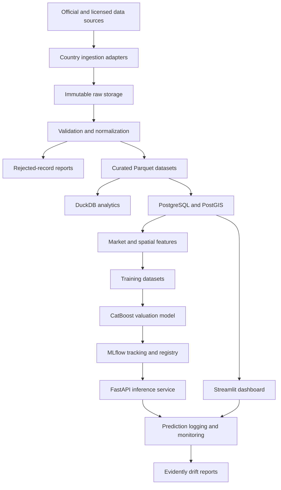

# European Property-Market Intelligence Platform

Production-oriented data platform for European residential real-estate analytics, automated valuation, market monitoring, and property screening.

The initial implementation targets **France** using geolocated DVF transactions. The architecture is country-extensible: each market keeps its own ingestion adapter, validation rules, feature pipeline, and valuation model while sharing a common platform layer.

> Statistical estimates only. This project is not a certified appraisal service, financial advice, or a substitute for legal and technical due diligence.

>This project is in an early concept phase. It is based only on theoretical data, my research into Python best practices, documentation, coding tutorials, and open-source code examples. Due to the complexity of the project, and my current Python knowledge, ChatGPT and Codex AI are sporadicly consulted for explanations and for determining the best course of action. AI is not used for code generation, only for code examination and helping in solving errors. It is used as fast search instead of manual digging through forums and documentation, but its sources are always read by me, and its opinion is never used as final without additional examination, and validation by me. This project is meant to be a part of my Python learning process, so I analyze everything and create notes. The goal is to learn Python on a large scale and use parts of this project and knowledge gained to create an actual production website that will be similar to cian.ru but on steroids.

> The final version of this file is written by me, checked and formated by AI.

---

## What the platform does

- Ingests versioned official transaction and market datasets.
- Preserves immutable raw files with checksums and source manifests.
- Normalizes country-specific records into a canonical transaction schema.
- Validates data quality and stores rejected records for auditability.
- Loads curated data into Parquet and PostgreSQL/PostGIS.
- Builds leakage-safe temporal and spatial market features.
- Trains and evaluates automated valuation models.
- Produces calibrated prediction intervals.
- Scores listings for potential overvaluation or undervaluation.
- Tracks experiments and model artifacts with MLflow.
- Serves predictions through FastAPI.
- Provides market analytics through Streamlit.
- Monitors data and prediction drift.
- Reproduces the pipeline through DVC.
- Runs quality checks, tests, and builds in CI.
- Packages the API as a Docker image.

---

## Architecture



### Storage responsibilities

| Layer | Purpose |
|---|---|
| Raw files | Immutable source snapshots and manifests |
| Parquet | Curated analytical datasets and reproducible model inputs |
| PostgreSQL/PostGIS | Indexed operational, spatial, and dashboard queries |
| MLflow | Experiment metrics, model artifacts, lineage, and promotion metadata |
| DVC | Dataset and pipeline versioning |

---

## Core design decisions

1. **Country-specific models** — European datasets differ in schema, coverage, licensing, and target quality.
2. **Temporal validation first** — random splits overstate real-world performance.
3. **Spatial holdout validation** — entire municipalities are held out to measure geographic generalization.
4. **No future leakage** — market aggregates use only information available before each transaction date.
5. **Prediction intervals** — the service returns central, lower, and upper estimates.
6. **Rejected records are retained** — filtering decisions remain inspectable and measurable.
7. **Public output is aggregated** — sensitive property-level records are not exposed unless clearly permitted.
8. **Training and serving are separate** — the API loads versioned artifacts and never trains at startup.

---

## Technology stack

| Area | Technologies |
|---|---|
| Language | Python 3.12+ |
| Data processing | Polars, pandas, PyArrow, DuckDB |
| Database | PostgreSQL, PostGIS, psycopg, SQLAlchemy |
| Modeling | CatBoost, scikit-learn, NumPy |
| Explainability | SHAP |
| Validation | Pandera and statistical checks |
| Experiment tracking | MLflow |
| Pipeline versioning | DVC |
| Monitoring | Evidently |
| API | FastAPI, Uvicorn |
| Dashboard | Streamlit, Plotly |
| Testing | pytest, pytest-cov |
| Quality | Ruff, mypy |
| Infrastructure | Docker, Docker Compose |
| CI | GitHub Actions |

---

## Repository layout

```text
.
├── data/
│   ├── raw/                  # Immutable source files
│   ├── curated/              # Validated Parquet datasets
│   ├── rejected/             # Rejected records and reasons
│   └── sample/               # Small CI-safe samples
├── docs/
│   ├── architecture.md
│   ├── data-card.md
│   ├── data-governance.md
│   ├── model-card.md
│   └── adr/
├── models/                   # Exported serving artifacts
├── reports/
│   ├── figures/
│   ├── metrics/
│   └── monitoring/
├── sql/
│   ├── 001_extensions.sql
│   ├── 002_transactions.sql
│   └── 003_market_features.sql
├── src/property_intelligence/
│   ├── api/
│   ├── dashboard/
│   ├── database/
│   ├── features/
│   ├── ingestion/
│   ├── modeling/
│   ├── monitoring/
│   ├── transformation/
│   └── validation/
├── tests/
│   ├── api/
│   ├── integration/
│   ├── statistical/
│   └── unit/
├── .github/workflows/ci.yml
├── docker-compose.yml
├── Dockerfile.api
├── dvc.yaml
├── params.yaml
├── pyproject.toml
└── README.md
```

---

## Data model

The canonical transaction schema contains only fields required for analysis and model training:

```text
transaction_key
source_name
source_transaction_id
country_code
currency_code
sale_date
sale_price
property_type
floor_area_m2
room_count
land_area_m2
admin_level_1
admin_level_2
municipality_code
municipality_name
longitude
latitude
geometry
source_file_sha256
loaded_at
```

Country adapters may preserve additional source-specific fields outside the canonical public schema.

---

## Data pipeline

```text
discover source
    → download immutable file
    → calculate SHA-256
    → write source manifest
    → validate schema
    → normalize records
    → retain rejected rows
    → write curated Parquet
    → load PostgreSQL/PostGIS
    → build lagged market features
    → create train/validation/test datasets
    → train and evaluate model
    → register serving artifact
```

### Initial source

The first implementation uses France's geolocated DVF property transactions.

The conservative training subset includes:

- Residential sales only.
- Houses and apartments.
- Positive sale price.
- Valid floor area.
- Valid coordinates.
- One residential unit per retained mutation.

This intentionally sacrifices coverage for cleaner supervision.

---

## Model objective

The first model predicts:

```text
log(1 + sale_price_per_m²)
```

Core features:

- Property type.
- Department.
- Municipality.
- Sale month.
- Floor area.
- Room count.
- Land area.
- Longitude and latitude.
- Lagged six-month municipality median price per m².
- Lagged six-month transaction volume.

### Baseline

The model must beat a historical median fallback hierarchy:

```text
municipality + property type
    → department + property type
    → country + property type
    → global training median
```

### Evaluation

Primary evaluation:

- Temporal holdout.
- Municipality holdout.
- Combined temporal and spatial stress test.

Reported metrics:

- MAE in price per m².
- RMSE in price per m².
- Median absolute percentage error.
- Error in total property value.
- Prediction-interval coverage.
- Average interval width.
- Segment performance by geography, property type, size, and price band.

A model is promoted only when it improves the champion without unacceptable regional regressions.

---

## Undervaluation score

The API returns:

- Predicted price per m².
- Lower and upper interval bounds.
- Predicted total property value.
- Conservative and central discount estimates when an asking price is supplied.

```python
central_discount = (
    predicted_value - asking_price
) / predicted_value

conservative_discount = (
    lower_predicted_value - asking_price
) / lower_predicted_value
```

The conservative score is preferred because it accounts for model uncertainty.

---

## Example

Example request:

```json
{
  "property_type": "Appartement",
  "admin_level_1": "75",
  "municipality_code": "75056",
  "floor_area_m2": 65,
  "room_count": 3,
  "land_area_m2": 0,
  "longitude": 2.35,
  "latitude": 48.86,
  "sale_month": 7,
  "rolling_median_price_m2_6m": 9500,
  "rolling_transaction_count_6m": 1500,
  "asking_price": 570000
}
```

Example response shape:

```json
{
  "predicted_price_m2": 9300.0,
  "lower_price_m2": 8100.0,
  "upper_price_m2": 10600.0,
  "predicted_total_value": 604500.0,
  "lower_total_value": 526500.0,
  "upper_total_value": 689000.0,
  "central_discount": 0.057,
  "conservative_discount": -0.083,
  "model_name": "france-dvf-valuation"
}
```

In production, rolling market features should be retrieved server-side from PostgreSQL rather than supplied by clients.

---

## Reproducibility with DVC

The DVC pipeline tracks:

```text
download → normalize → feature build → train
```

Run changed stages:

```bash
dvc repro
```

Inspect the pipeline:

```bash
dvc dag
```

Git tracks code and metadata; DVC tracks data and model artifacts.

---

## CI

GitHub Actions runs:

1. Dependency installation.
2. Ruff linting.
3. Formatting verification.
4. Strict mypy checks.
5. Parallel pytest execution.
6. Python package build.

Full training, image publishing, and deployment should use separate protected workflows.

---

## Data governance

The platform separates software licensing from data licensing.

Required controls:

- Preserve source license and attribution metadata.
- Do not expose personal data.
- Do not publish exact records where source terms restrict it.
- Keep exact coordinates in protected storage.
- Aggregate public analytics.
- Log dataset lineage and retrieval timestamps.
- Document retention and deletion policies.
- Avoid unnecessary retention of user-submitted data.

Each source must have a data card covering publisher, geographic and temporal scope, refresh frequency, license, attribution, known limitations, and redistribution restrictions.

---

## Known limitations

The first model does not directly observe:

- Interior condition.
- Structural defects.
- Legal disputes.
- Occupancy.
- Renovation quality.
- Exact floor and orientation.
- View and noise.
- Building maintenance.
- Unregistered additions.
- Seller urgency.

Additional limitations:

- DVF mutations may represent complex multi-property transactions.
- Sparse municipalities produce wider uncertainty.
- Historical models may react slowly to abrupt market changes.
- Asking prices and realized sale prices are different targets.
- SHAP explains model behavior but does not prove causal relationships.
- Public valuation output must not be represented as a certified appraisal.

---

## Project maturity criteria

The first country implementation is complete when it has:

- Reproducible source ingestion.
- Immutable manifests and checksums.
- Validated canonical data.
- Measured rejection rates.
- Leakage-safe features.
- Baseline comparison.
- Temporal and spatial evaluation.
- Calibrated uncertainty intervals.
- MLflow experiment tracking.
- Versioned serving artifacts.
- FastAPI and Streamlit interfaces.
- Drift monitoring.
- DVC reproducibility.
- Automated tests and CI.
- A hardened API container.
- Data and model documentation.

Only then should additional countries be added.
